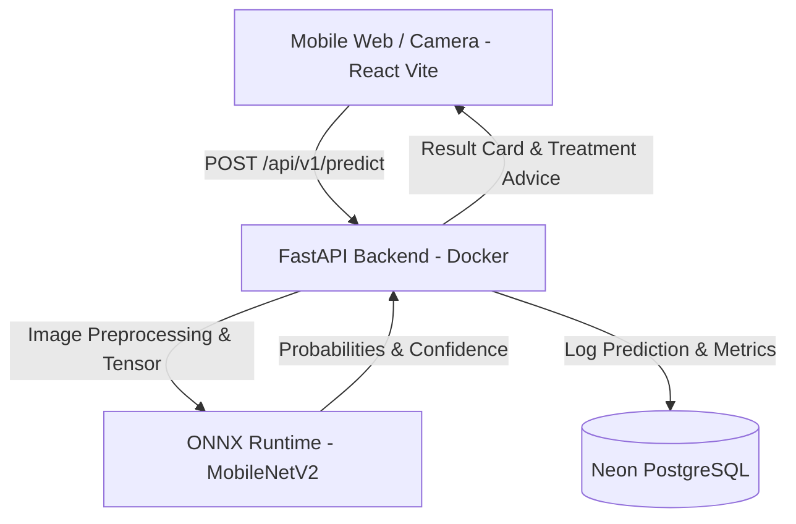

# AgriVision 🍅🔍

> High-accuracy, mobile-first crop disease diagnosis for farmers.

AgriVision allows a farmer to photograph a tomato leaf and receive instant disease diagnosis, confidence metrics, and actionable care guidance.

---

## 🏗️ Architecture



- **Frontend:** React (Vite, TypeScript/JS, Mobile-First PWA design)
- **Backend:** FastAPI (Python 3.11+, Structured Logging, Pydantic v2)
- **Inference Engine:** ONNX Runtime (MobileNetV2 exported from PyTorch)
- **Database:** Neon PostgreSQL (stores prediction logs, feedback loop, history)
- **CI/CD:** GitHub Actions (linting, testing, Docker container verification)
- **Deployment:** Vercel (Frontend) + Render (Backend)

---

## 📁 Repository Structure

```
agrivision/
├── AGENTS.md                  # Team role, engineering protocol, non-negotiable rules
├── README.md                  # Project overview and developer onboarding
├── CHANGELOG.md               # Versioned changelog tracking milestones
├── .gitignore                 # Exclusion rules for secrets, dependencies, models
├── .env.example               # Environment variable contract
├── .pre-commit-config.yaml    # Local commit hooks (linting, secret check)
├── docs/                      # Technical documentation & architectural decision records
│   ├── PROJECT_PLAN.md        # Comprehensive phase roadmap & Definitions of Done
│   ├── PROGRESS.md            # Active phase tracker
│   ├── LEARNING_LOG.md        # Engineering concepts & interview preparation
│   └── adr/                   # Architecture Decision Records (ADRs)
├── ml/                        # ML pipeline: data ingestion, training, ONNX export
├── backend/                   # FastAPI backend service
│   ├── app/
│   │   ├── api/               # API endpoints (/predict, /health, /feedback)
│   │   ├── core/              # Settings & logging configuration
│   │   ├── db/                # Database connection & models
│   │   ├── schemas/           # Pydantic schemas (request/response)
│   │   └── services/          # Business logic & ONNX inference service
│   └── tests/                 # Backend unit & integration test suite
└── frontend/                  # React (Vite) client application
```

---

## ⚡ 5-Minute Quickstart

### Prerequisites
- Python 3.11+
- Node.js 18+ & npm
- Git

### 1. Clone the repository
```bash
git clone https://github.com/Abhilash-K-R/AgriVision.git
cd AgriVision
```

### 2. Configure Environment Variables
```bash
# Copy the environment contract to .env
cp .env.example .env
```
*Review `.env` and configure your database URL or leave defaults for local development.*

### 3. Setup Pre-commit Hooks
```bash
pip install pre-commit
pre-commit install
```

---

## 🛡️ Engineering Standards

We follow strict production standards:
1. **No commits to `main`:** All work happens on feature branches (`feat/...`, `fix/...`, `docs/...`).
2. **Conventional Commits:** `feat:`, `fix:`, `docs:`, `test:`, `chore:`, `refactor:`.
3. **Zero Secrets in Git:** All secrets live in `.env` (which is git-ignored).
4. **Structured Logging:** No `print()` statements. Python `logging` with request IDs.
5. **Tests with Code:** Features must include unit and integration tests.

---

## 🗺️ Project Phases

- [x] **Phase 0:** Foundation (Repo structure, standards, git hygiene)
- [ ] **Phase 1:** Requirements & Design (PRD, Class scope, Architecture, ADRs)
- [ ] **Phase 2:** Data Engineering (PlantVillage dataset, leak-free train/val/test split)
- [ ] **Phase 3:** Model Training & ONNX Export (Transfer learning, MobileNetV2, Model Card)
- [ ] **Phase 4:** FastAPI Backend (Endpoints, validation, error handling, test suite)
- [ ] **Phase 5:** React Frontend (Camera capture, diagnosis card, offline/error handling)
- [ ] **Phase 6:** Quality & CI (GitHub Actions pipeline, linting, test automation)
- [ ] **Phase 7:** Production Deployment (Docker, Neon Postgres, Render + Vercel)
- [ ] **Phase 8:** Observability & Real-World Validation (Domain gap testing, feedback analytics)
- [ ] **Phase 9:** Release (v1.0.0, documentation, retrospective)
